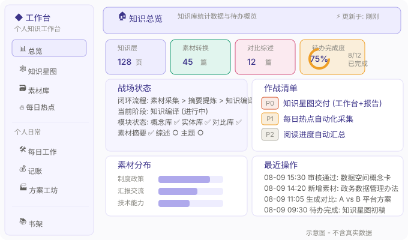
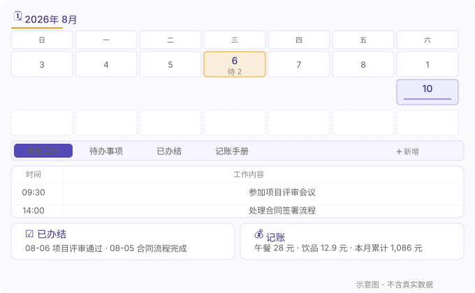

# 知识工作台 (Knowledge Workbench)

> 本地优先的个人 AI 知识工作台。将 Obsidian/Markdown 知识库升级为可交互 Web 应用。
> 青屿作战台设计系统 · Node.js 零外部依赖 · 浏览器即客户端 · 前端常用库本地化。

---

## 目录

- [快速开始](#快速开始)
- [前置条件：设置你的知识库](#前置条件设置你的知识库)
  - [推荐方案：Obsidian](#推荐方案obsidian----最自然的管理方式)
  - [替代方案：不用 Obsidian 也行](#替代方案不用-obsidian-也行)
- [一键部署](#一键部署推荐)
- [功能总览](#功能总览)
- [截图展示](#截图展示)
- [模块详解](#模块详解)
  - [总览 Dashboard](#总览-dashboard)
  - [知识星图](#知识星图)
  - [知识导航](#知识导航)
  - [素材库](#素材库)
  - [每日热点](#每日热点)
  - [知识层](#知识层)
  - [头脑风暴](#头脑风暴)
  - [AI 对话（信箱桥）](#ai-对话信箱桥)
  - [每日工作 & 待办](#每日工作--待办)
  - [记账](#记账)
  - [方案工坊](#方案工坊)
  - [运行档案](#运行档案)
  - [书架](#书架)
  - [全库搜索](#全库搜索)
- [技术架构](#技术架构)
  - [后端](#后端)
  - [前端](#前端)
  - [数据层](#数据层)
- [API 一览](#api-一览)
- [工具集](工具/README.md)
- [定时任务](自动化/README.md)
- [AGENTS.md 示例（主控 Schema）](AGENTS-示例.md)
- [更新记录](CHANGELOG.md)
- [目录结构](#目录结构)
- [数据格式约定](#数据格式约定)
- [许可证](#许可证)

---

## 快速开始

```bash
# 1. 克隆仓库
git clone <this-repo>
cd workbench-forge

# 2. 把「知识库骨架」解压到你的知识库目录（例如 ~/Documents/MyKB），然后把工作台指向它
# 前提是本地已安装 Node.js
# 启动方式一：环境变量
export WB_KB_ROOT="你的知识库目录路径"
node 工作台/server.js

# 启动方式二：直接把 server.js 第 14 行的 KB_ROOT fallback 改成你的路径
node 工作台/server.js
```

打开浏览器访问 `http://localhost:5173` 即可。

---

## 前置条件：设置你的知识库

> 工作台不存储数据 —— 它只是你的知识库目录的一个「窗口」。你需要先有一个知识库目录。
> 从零开始的话，直接把 [`知识库骨架/`](知识库骨架/README.md) 复制成你的知识库目录：里面有四层结构、五个页面模板、四个索引文件的格式，以及一份讲清「素材怎么变成知识」的机制说明。

### 推荐方案：Obsidian —— 最自然的管理方式

[**Obsidian**](https://obsidian.md/) 是工作台生态的首选 Markdown 编辑器。工作台的数据格式（`[[WikiLink]]`、`YAML Frontmatter`）与 Obsidian 完全兼容，两者配合使用体验最佳。

**为什么推荐 Obsidian？**
- **双向链接**：`[[页面名]]` 即写即连，知识自动编织成网
- **图谱视图**：可视化你的知识网络（工作台的知识星图就是 Web 版图谱）
- **Frontmatter 编辑**：YAML 元数据有专门编辑器，不用手写
- **本地优先**：所有文件都在你本地，不依赖云服务
- **插件生态**：日历、看板、数据视图等海量插件

**安装步骤：**

1. 前往 [obsidian.md](https://obsidian.md/) 下载对应系统的 Obsidian
2. 安装后打开 Obsidian，选择 **「打开本地仓库」(Open folder as vault)**
3. 选择你的知识库目录（即之前设置的 `WB_KB_ROOT` 路径）
4. 你将看到工作台生成的完整目录结构

**在 Obsidian 中你可以：**
- 双击 `[[` 自动补全页面名创建双向链接
- 拖入图片自动生成 `![[图片名]]` 嵌入
- 用 `Ctrl/Cmd + E` 切换编辑/预览模式
- 用左侧图谱按钮查看知识关系网络

### 替代方案：不用 Obsidian 也行

工作台的「知识库」本质上就是**一个包含 Markdown 文件的普通文件夹**。你可以用任何工具编辑：

| 工具 | 适用场景 | 说明 |
|------|----------|------|
| **VS Code** | 程序员首选 | 装 Markdown 插件后体验接近 IDE，支持 WikiLink 语法高亮 |
| **Typora** | 所见即所得 | 付费但体验优秀，专注写作场景 |
| **系统记事本** | 应急情况 | 能写 `.md` 就行，但缺少语法辅助 |
| **让 AI 帮你写** | 最省心 | 把内容告诉 WorkBuddy，AI 会按格式写入，你只负责看 |

**核心格式只有两个：**

**1. WikiLink（页面链接）**
```markdown
[[数据空间]]            ← 链接到「数据空间.md」
[[数据空间|点这里看]]    ← 带别名
![[截图.png]]           ← 嵌入图片
```
不用 Obsidian 的话，手写这两对方括号即可。

**2. YAML Frontmatter（文件头元数据）**
```yaml
---
title: "数据空间"
type: concept
tags: ["项目管理", "知识库"]
---
```
每个 `.md` 文件开头 `---` 之间的内容。用于分类、标签、来源标注。

> **💡 索引不依赖 Obsidian**：工作台的知识星图、全文搜索、标签分类、关联推荐等所有索引能力，全部基于 `server.js` 直接解析 `.md` 文件中的纯文本（`[[链接]]`、`YAML Frontmatter`、正文内容）。不需要 Obsidian 数据库、不需要插件 —— 只要格式写对，用什么编辑器写的都一样生效。
>
> **⚠️ 提醒**：工作台写入「每日工作/待办/记账」时是**覆盖写**（不是追加），所以不要同时用两个工具编辑同一天的 `日常/YYYY-MM-DD.md`，否则可能丢失数据。

---

## 一键部署（推荐）

**将此仓库下载到本地后，让 AI 帮你完成配置和启动。** 详见 [DEPLOY.md](DEPLOY.md)。

---

## 功能总览

| 模块 | 说明 | 核心技术 |
|------|------|----------|
| 总览 Dashboard | 知识库全景统计 + 素材分类迷你图 + 待审卡片 + 近期操作 | 实时文件扫描 + 内存缓存 |
| 摄入质检 | 待审卡片验收 + **打回重写**（AI 按意见基于源素材真实重写，覆盖写回再进待审）| frontmatter review 状态机 + 自动化信箱桥 |
| 长期待办 | 跨日滚动待办池 + 勾选/删除**二次确认** + 完结**安全归档**到当天已办结表 | 独立 Markdown 文件 + 安全插行写入 |
| 知识星图 | 概念 / 实体 / 素材关系网络 | D3.js 力导向图 + 双向链接解析 |
| 知识导航 | 关系边**带语境**：每条连边附「引用所在小节 + 摘要」与语义关系类型 | 双链语境采集 + frontmatter 关系聚合 |
| 素材库 | 原始素材文件浏览 + 全文搜索 + **AI回答** 类型 | 目录树 + MiniSearch 全文索引 |
| 每日热点 | AI 资讯自动补给线 | Markdown 文件列表 + 日期解析 |
| 知识层 | AI 编译的知识网络（概念/实体/摘要/**AI回答提炼**/对比/综述）| YAML Frontmatter 分类聚合 |
| 头脑风暴 | 读库 → 追问 → 写回的知识复利闭环 | 关联推荐 + Markdown 草稿 |
| AI 对话 | 信箱桥：提问入箱 → Agent 读库回答 → **回答可提炼入库** | 文件入箱/出箱 + WorkBuddy 自动化触发 |
| 每日工作 | 待办事项 + 每日工作记录 + 办结归档 | 日历视图 + 智能排期 + 依赖链 |
| 记账 | 收支记录 + 一二级分类 | 表格解析 + 分类表联动 |
| 方案工坊 | 方案组件 + 实战产出 | Markdown 渲染 + 文件索引 |
| 运行档案 | 操作日志时间线 | 日志文件读取 |
| 书架 | 本地 PDF / TXT 导入 · 待读→在读→已读 | PDF.js + TXT 编码探测 + 章节识别 |
| 全库搜索 | 标题/正文/标签/别名全文检索 + **命中来源标注** | MiniSearch + 中文分词 |

---

## 截图展示

### 总览 Dashboard



**Dashboard 展示：**
- 顶部横幅：知识库状态概览
- 统计卡片：知识层页面数、素材转换稿数、对比/综述数、待办完成度环形图
- 战场状态：闭环流程、阶段进度、模块状态
- 作战清单：P0/P1/P2 优先级待办，带时间词智能排期与依赖链
- 素材分布：按分类统计的横向条形图
- 最近操作：操作日志时间线

> 以上为布局示意图（SVG），不含用户个人数据。实际内容取决于你的知识库数据。

### 每日工作 & 日历



**日历视图：**
- 月历组件，有待办的日期高亮显示角标
- 已办结日期底部标记
- 点击日期切换当日工作面板
- 当前日期高亮显示

**工作面板：**
- 每日工作：表格录入（`| 时间 | 工作内容 |`）
- 待办事项：智能排期（识别「下周三」「明天」等时间词自动归档到对应日期）+ 依赖链（等待前置 / 下游依赖悬浮查看）
- 已办结：办结日期 + 事项 + 会议纪要关联
- 记账手册：时间 / 类型 / 一二级分类 / 金额 / 说明

> 以上为布局示意图（SVG），不含用户个人数据。实际内容取决于你的知识库数据。

---

## 模块详解

### 总览 Dashboard

**功能：** 打开工作台第一眼看到的「作战指挥室」。

**实现方式：**
- 后端 `apiStats()` 实时扫描知识层目录（`知识层/概念/实体/素材摘要/AI回答提炼/对比/综述/`）统计各类页面数量。
- 扫描 `原始素材/文章/` 统计转换稿总数，并按 7 大关键词分组（制度政策 / 汇报交流 / 申报材料 / 工具模板 / 商务合作 / 技术能力 / 业务场景）。
- 扫描知识层中 `review: pending` 的 Frontmatter 标记，生成「待审卡片」列表。
- 读取 `知识层/_操作日志.md` 最新 6 条作为「最近操作」。
- 内存缓存 5 分钟（`CACHE_TTL`），重启失效，避免每次刷新都全库扫描。

**关键代码：** `server.js:136-216`

---

### 知识星图

**功能：** 将知识层中的所有 Markdown 页面渲染为交互式力导向图，直观展示概念/实体/素材之间的关联。

**实现方式：**
- 后端 `apiGraph()` 遍历 `知识层/` 下所有 `.md` 文件，提取 `[[WikiLink]]` 双向链接语法。
- 构建节点（nodes）和边（links）JSON，按页面类型着色（概念紫 / 素材摘要青 / 实体绿 / 对比橙 / 综述红）。
- 前端懒加载 D3.js（`loadD3()`），仅在进入星图页面时才从 CDN 加载。
- `drawGraphD3()` 使用 `d3.forceSimulation`：
  - `forceLink`：链接距离 90，连接强度 0.3
  - `forceManyBody`：电荷力 -320（节点互斥）
  - `forceCenter`：向画布中心聚拢
  - `forceCollide`：碰撞检测避免重叠
- 支持：滚轮缩放、拖拽节点、点击节点查看相邻页面（弹层展示双向链接关系）、图例点击筛选类型。

**关键代码：** `server.js:301-341` · `app.js:890-1028`

---

### 知识导航

**功能：** 把知识层页面之间的关系摊开来看——不仅知道"谁连着谁"，还能看到"为什么连着"。

**实现方式：**
- 后端 `/api/navigation` 汇总两类关系：
  - **正文双链**：`collectWikiLinkContexts()` 逐行扫描 `.md`，记录每条 `[[链接]]` 最近的上层小节标题，并截取引用所在行摘要作为语境。
  - **frontmatter 语义关系**：`collectFrontmatterRelations()` 读取 `relation_type`，即使正文没有双链，也把声明式关系纳入。
- `flattenRelations()` 把两类关系统一成边列表，按 `(source, target)` 聚合成 `{source, target, count, contexts[], relations[]}`。
- 前端 `renderNavigator()` 渲染关系清单；若后台返回旧结构，直接提示「后台仍是旧进程」，避免静默失败。

> ⚠️ 解析 Markdown 行位置不要用全局字符下标反推行号——CRLF 文件每行多占 1 个字符会累积偏移。本模块改为逐行扫描。

**关键代码：** `server.js` 的 `apiNavigation()` / `collectWikiLinkContexts()` · `app.js` 的 `renderNavigator()`

---

### 素材库

**功能：** 浏览「原始素材」目录下的所有文章、图片、PPT 等文件。

**实现方式：**
- 后端 `walkRawFiles()` 递归扫描 `原始素材/` 下的一级子目录（排除 `_` 前缀目录）。
- 收集 `.md/.png/.jpg/.jpeg/.webp/.gif/.svg/.pptx/.ppt` 文件，记录修改时间并倒序排列。
- 前端提供「目录树视图」和「列表视图」两种模式。
- 点击文件可直接预览：Markdown 走 `mdToHtml()` 渲染（支持 Obsidian `![[图片]]` 语法），图片直接显示，PPT 仅展示文件名。
- 阅读时自动收起侧边栏（`autoCollapseForReading()`），最大化阅读空间。

**关键代码：** `server.js:92-116` · `app.js:1032-1170`

---

### 每日热点

**功能：** 展示 AI 资讯早报（每日自动采集的热点 Markdown）。

**实现方式：**
- 扫描 `原始素材/热点/` 目录下的 `.md` 文件，按文件名（日期前缀）倒序排列。
- 解析 YAML Frontmatter 提取标题，统计正文中的 `1. / 2. / 3.` 序号条目数量作为「条数」。
- 展示日期、标题、条数、前 260 字摘要。

**关键代码：** `server.js:343-366`

---

### 知识层

**功能：** AI 编译的知识网络中枢，包含概念卡、实体卡、素材摘要、对比分析、综述等结构化知识。

**实现方式：**
- 目录约定：
  - `知识层/概念/` —— 抽象概念定义
  - `知识层/实体/` —— 具体实体（人、机构、产品）
  - `知识层/素材摘要/` —— 原始素材的 AI 提炼
  - `知识层/对比/` —— 多事物对比分析
  - `知识层/综述/` —— 主题综述
  - `知识层/主题/` —— 主题聚合
- 每个文件使用 YAML Frontmatter 标注元数据：
  ```yaml
  ---
  title: "标题"
  type: concept
  tags: ["标签1", "标签2"]
  source:
    - "原始素材/文章/xxx.md"
  review: pending   # 待审标记
  ---
  ```
- 前端按类型分 Tab 展示，支持点击打开阅读器。
- 阅读器右侧显示「关联推荐」：基于关键词（Frontmatter tags + 标题词 + 正文 2-gram 高频词）计算余弦相似度，返回最相关的 8 篇。

**关键代码：** `server.js:48-75` · `app.js:1269-1315`

---

### 头脑风暴

**功能：** 阅读知识库内容时随时记录灵感，支持追问和写回知识库。

**实现方式：**
- 页面分为两栏：左侧笔记输入区，右侧关联素材推荐区。
- 输入笔记标题和内容，点击保存 → 后端 `apiDraft()` 写入 `输出/查询/drafts/` 目录，自动生成 Markdown 文件。
- 右侧「关联推荐」调用 `apiRelated()`，基于当前输入内容的关键词匹配推荐相关知识页。
- 支持「基于此追问」：选中素材后带入上下文，直接跳转到 AI 对话页面提问。

**关键代码：** `server.js:385-414` · `app.js:1317-1369`

---

### AI 对话（信箱桥）

**功能：** 提问入箱 → Agent 读库回答 → 结果写回的异步对话系统。

**实现方式：**
- **提问端**：用户在 AI 对话页面输入问题，前端调用 `POST /api/ask`，后端将问题写入 `输出/查询/inbox/YYYYMMDD-HHMMSS.md`，附带 YAML Frontmatter（id, status: pending, askedAt, question）。
- **触发端（可选）**：用户可以点击「立即唤醒 Agent」按钮，前端调用 `POST /api/trigger`。如配置了环境变量 `WB_AI_SERVICE_AUTOMATION_ID`，后端会操作 WorkBuddy 的 SQLite 数据库（`~/.workbuddy/workbuddy.db`），将对应自动化的 `next_run_at` 修改为当前时间戳，调度器下一轮即执行；未配置时仅写入 inbox，等待外部流程取件。
- **回答端**：WorkBuddy 自动化脚本读取 inbox 中 `status: pending` 的文件，调用 AI 进行回答，结果写入 `输出/查询/answers/YYYYMMDD-HHMMSS.md`，并将 inbox 中对应文件标记为 `status: done`。
- **展示端**：前端同时展示 inbox（待回答）和 answers（已回答）两个列表，支持追问和基于上下文的继续提问。

**关键代码：** `server.js:416-502` · `app.js:1371-1450`

---

### 每日工作 & 待办

**功能：** 日历视图 + 每日工作记录 + 智能排期待办 + 依赖链 + 办结归档。

**实现方式：**
- **数据格式**：每个日期的数据存储为 `日常/YYYY-MM-DD.md`，固定包含 4 个区块：
  1. `## 每日工作` —— `| 时间 | 工作内容 |` 表格
  2. `## 待办事项` —— `- [ ] / - [x]` 复选框列表
  3. `## 已办结事项` —— `| 办结日期 | 事项 | 会议纪要 |` 表格
  4. `## 记账手册` —— `| 时间 | 类型 | 一级分类 | 二级分类 | 金额 | 说明 |` 表格
- **智能排期**：用户输入待办时，前端解析文本中的时间词（如「下周三」「明天」「8-15」），自动计算目标日期并将待办写入对应日期的文件。
- **依赖链**：待办文本中可包含 `等待前置：xxx` 或 `下游依赖：yyy`，前端解析后生成悬浮提示，并在全库索引中查找匹配的已办结/待办项。
- **日历视图**：前端 `renderDailyCalendar()` 生成月历，调用 `apiDailyList()` 获取所有有记录的日期，有「待办」的日期显示黄色角标，有「已办结」的日期底部加紫线。
- **写回机制**：`POST /api/daily` 接收完整 JSON，后端按固定模板整体写回 Markdown 文件（注意：这是**覆盖写**，不是增量）。

**关键代码：** `server.js:504-578` · `app.js:1540-1803`

---

### 记账

**功能：** 收支记录 + 一二级分类联动 + 月度统计。

**实现方式：**
- 收支数据存储在每日 Markdown 的「记账手册」表格中（见上文）。
- 分类定义在 `日常/_分类表.md`，后端 `apiCategories()` 解析该文件生成支出/收入的两级分类树。
- 前端添加记录时，先选择「收入/支出」，再联动加载对应的一级分类，选择一级后联动加载二级分类。
- 月度统计：前端遍历当月所有日期的记账数据，按一级分类聚合金额，渲染条形图和汇总数字。

**关键代码：** `server.js:676-696` · `app.js:1981-2093`

---

### 方案工坊

**功能：** 方案组件库 + 实战产出展示。

**实现方式：**
- 扫描 `原始素材/文章/`、`知识层/`、`输出/报告/` 下的所有 Markdown 文件。
- 支持按文件名关键词搜索过滤。
- 展示为卡片列表，点击打开阅读器。

**关键代码：** `server.js:597-619` · `app.js:2095-2121`

---

### 运行档案

**功能：** 知识库操作日志时间线。

**实现方式：**
- 读取 `知识层/_操作日志.md`，提取所有以 `- [` 开头的行。
- 按时间倒序展示为时间线列表。

**关键代码：** `server.js:719-723` · `app.js:2123-2144`

---

### 书架

**功能：** 本地 PDF / TXT 导入、阅读状态追踪（待读→在读→已读）、阅读进度保存、PDF 阅读器（支持单页/双页/缩放）。

**实现方式：**
- **导入**：前端上传 PDF/TXT 文件，`POST /api/bookshelf/upload`：
  - PDF 直接存入 `书架/books/`。
  - TXT 自动进行编码探测（优先 UTF-8，失败回退 GB18030）→ 章节识别（正则匹配「第X章」「Chapter X」「楔子」等）→ 转为 Markdown 格式 → 存入 `书架/books/`。
  - 同时在 `书架/books.json` 中追加书籍元数据（id, title, status, progress, pages 等）。
- **阅读状态**：`unread`（待读）→ `reading`（在读，首次打开自动切换）→ `done`（已读，手动标记）。
- **PDF 阅读器**：使用本地 PDF.js（`assets/pdfjs/`），支持：
  - 单页 / 双页对开模式切换
  - 缩放（50% - 200%）
  - 页码跳转
  - 阅读进度标记（记录当前页到 `books.json`）
- **TXT 阅读器**：复用 `mdToHtml()` 渲染为网页文本，支持章节导航。

**关键代码：** `server.js:778-909` · `app.js:2146-2348`

---

### 全库搜索

**功能：** 标题 / 正文 / 标签全文检索，支持高亮和摘要。

**实现方式：**
- 前端集成 [MiniSearch](https://github.com/lucaong/minisearch)（CDN 引入）。
- **中文分词**：自定义 `cnTokenizer()` 实现：
  - 按标点分词
  - 中文文本进行单字 + 2-gram 切分（如「数据空间」→ `数, 据, 空, 间, 数据, 据空, 空间`）
  - 英文保持整词
- 后端 `apiSearchIndex()` 扫描全库 Markdown，提取标题 + 正文（清理 Markdown 标记，截取前 2000 字）+ 标签，返回文档数组。
- 前端 `getSearchIndex()` 将文档注入 MiniSearch，建立内存索引。
- 搜索选项：标题权重 4x，标签权重 2x，模糊匹配 0.2，前缀匹配开启，AND 组合。
- 结果高亮：命中词在标题和摘要中用 `<mark>` 标注。

**关键代码：** `app.js:95-174`

---

## 技术架构

### 后端

- **运行时**：Node.js（仅使用内置模块）
- **依赖**：**零外部 npm 包**
- **使用的内置模块**：
  - `http` —— HTTP 服务器
  - `fs` / `path` / `url` / `os` —— 文件系统、路径、URL 解析、系统信息
  - `node:sqlite`（Node 22+）—— 直接读写 WorkBuddy SQLite 数据库用于触发自动化
- **架构模式**：单文件 http.createServer，路由分发 + API handler
- **安全**：`safeJoin()` 防止路径遍历；静态文件限制在 `APP_DIR` 内；知识库文件只允许读取特定白名单目录（`原始素材/知识层/输出/AI研究/日常/制度文件/书架` 等）
- **缓存策略**：搜索索引和知识星图使用内存缓存（5 分钟 TTL），重启即失效

### 前端

- **框架**：原生 JavaScript SPA（无 React/Vue/Angular）
- **路由**：Hash 路由（`#/`），`history.replaceState` + `hashchange` 事件
- **Markdown 渲染**：[marked.js](https://marked.js.org/)（CDN）
- **全文搜索**：[MiniSearch](https://github.com/lucaong/minisearch)（CDN）
- **知识星图**：[D3.js v7](https://d3js.org/)（CDN，懒加载）
- **PDF 阅读**：[PDF.js](https://mozilla.github.io/pdf.js/)（本地静态文件，离线可用）
- **样式**：纯 CSS，青屿作战台设计系统（CSS 变量系统），卡片化界面，响应式侧边栏
- **动效**：独立 `fx.js` 文件，数字滚动、环形进度动画、条形图展开、入场 stagger；通过 `MutationObserver` 自动适配动态内容；尊重 `prefers-reduced-motion`

### 数据层

- **存储介质**：纯 Markdown 文件 + JSON 文件
- **元数据格式**：YAML Frontmatter（Obsidian 兼容）
- **知识库目录结构约定**：
  ```
  知识库根目录/
  ├── 日常/               # 每日工作 + 待办 + 记账
  │   ├── _模板.md        # 每日文件模板
  │   ├── _分类表.md      # 记账分类定义
  │   └── 2026-08-10.md   # 具体日期文件
  ├── 原始素材/
  │   ├── 文章/           # 转换稿、会议纪要等
  │   ├── 热点/           # 每日热点早报
  │   └── 图片/           # 配图素材
  ├── 知识层/             # AI 编译的知识网络
  │   ├── 概念/
  │   ├── 实体/
  │   ├── 素材摘要/
  │   ├── 对比/
  │   ├── 综述/
  │   ├── 主题/
  │   └── _操作日志.md
  ├── 输出/
  │   ├── 查询/
  │   │   ├── inbox/      # AI 提问箱
  │   │   ├── answers/    # AI 回答
  │   │   └── drafts/     # 头脑风暴草稿
  │   └── 报告/
  └── 书架/
      ├── books/          # 上传的 PDF/TXT（转 md）
      └── books.json      # 书籍元数据索引
  ```

---

## API 一览

| 端点 | 方法 | 说明 |
|------|------|------|
| `GET /api/stats` | GET | 总览统计数据 |
| `GET /api/files?type=wiki/raw/article` | GET | 文件列表 |
| `GET /api/file?path=...` | GET | 读取单个文件内容 + Frontmatter + 链接 |
| `GET /api/search?q=...&scope=...` | GET | 基础搜索（服务端实现） |
| `GET /api/search-index` | GET | 返回全库文档数组供 MiniSearch 索引 |
| `GET /api/graph` | GET | 知识星图节点和边数据 |
| `GET /api/hotspots` | GET | 每日热点列表 |
| `GET /api/related?path=...` | GET | 关联推荐（基于关键词相似度） |
| `GET /api/inbox` | GET | 待回答提问列表 |
| `GET /api/answers` | GET | 已回答问题列表 |
| `POST /api/ask` | POST | 提交新问题到 inbox |
| `POST /api/trigger` | POST | 可选：按 `WB_AI_SERVICE_AUTOMATION_ID` 唤醒 WorkBuddy AI 自动化 |
| `GET /api/todo` | GET | 作战清单（学习作战室.md） |
| `GET /api/log` | GET | 操作日志 |
| `POST /api/draft` | POST | 保存头脑风暴草稿 |
| `POST /api/review` | POST | 审核通过/打回（修改 Frontmatter review 字段） |
| `GET/POST /api/daily?date=...` | GET/POST | 读取/写回某日日常文件 |
| `GET /api/daily/list` | GET | 所有有记录的日期列表 |
| `GET /api/categories` | GET | 记账分类表 |
| `GET /api/meetings` | GET | 会议纪要文件列表 |
| `POST /api/meetings/upload` | POST | 上传会议纪要 |
| `GET /api/docs?q=...` | GET | 全库文档搜索（按文件名过滤） |
| `GET /api/bookshelf` | GET | 书架书籍列表 |
| `POST /api/bookshelf/upload` | POST | 上传 PDF/TXT |
| `POST /api/bookshelf/progress` | POST | 更新阅读进度和状态 |

---

## 目录结构

```
workbench-forge/
├── 工作台/               ← Web 应用源码
│   ├── server.js         ← Node.js 后端（零依赖，~985 行）
│   ├── app.js            ← 前端逻辑（SPA，~2350 行）
│   ├── index.html        ← 入口页
│   ├── style.css         ← 青屿作战台设计系统
│   ├── fx.js             ← 动效增强层
│   └── assets/           ← 静态资源
│       ├── banner.png
│       └── pdfjs/        ← PDF.js 本地离线版
│           ├── pdf.min.js
│           └── pdf.worker.min.js
├── 知识库骨架/           ← 知识库初始结构（目录 + 模板 + 索引格式）
│   ├── README.md         ← 知识库怎么运转：自循环 / 切片 / 分类
│   ├── 原始素材/         ← 原料区（文章/论文/逐字稿/数据/热点/图片/附件/随手笔记）
│   ├── 知识层/
│   │   ├── _总索引.md  _路由表.md  _操作日志.md  _全局综述.md
│   │   ├── _模板/        ← 素材摘要/概念/实体/对比/活动模板 + 关系类型标签规范
│   │   ├── 素材摘要/  概念/  实体/  对比/  综述/  活动/  提示词/
│   │   └── 主题/_示例主题/_索引.md
│   ├── 日常/             ← 每日页 + 日报模板 + 周报模板
│   ├── 书架/
│   └── 输出/
├── 工具/                 ← 本地小工具（零依赖 Python 脚本）
│   ├── 联网搜索/
│   │   ├── ds_search.py          ← 全网搜索 / 抓取，落盘成 Markdown
│   │   └── 知乎检索/             ← 站内检索 / 热榜 / 高赞回答精选
│   └── PPT审核/
│       ├── layout_check.py       ← 版面静态预估
│       └── render_check.py       ← 版面渲染实测
├── 自动化/               ← 定时任务模板（脱敏后的 prompt）
│   ├── README.md
│   └── prompts/          ← 6 个可直接复用的任务 prompt
├── AGENTS-示例.md        ← 主控 Schema 骨架（工具治理 / 权限 / 规范）
├── screenshot-dashboard.svg  ← Dashboard 布局示意图
├── screenshot-todo.svg       ← 每日工作布局示意图
├── DEPLOY.md             ← AI 一键部署提示词
└── README.md             ← 本文件
```

---

## 数据格式约定

### 每日文件模板（`日常/YYYY-MM-DD.md`）

```markdown
---
date: 2026-08-10
type: daily
---

## 每日工作

| 时间 | 工作内容 |
|---|---|
| 09:30 | 参加某项目评审会议 |
| 14:00 | 处理合同流程问题 |

## 待办事项

- [x] 跟进项目A数据
- [ ] 周三跟进项目B小程序上架

## 已办结事项

| 办结日期 | 事项 | 会议纪要 |
|---|---|---|
| 2026-08-10 | 项目评审 | 原始素材/文章/会议纪要-20260810-项目评审.md |

## 记账手册

| 时间 | 类型 | 一级分类 | 二级分类 | 金额(元) | 说明 |
|---|---|---|---|---|---|
| 12:00 | 支出 | 餐饮美食 | 午餐 | 28 | 午餐费用 |
| 14:30 | 支出 | 餐饮美食 | 饮品 | 12.9 | 下午茶 |
```

### 知识层 Frontmatter

```yaml
---
title: "数据空间"
type: concept
tags: ["项目管理", "知识库", "方法论"]
source:
  - "原始素材/文章/可信数据空间建设指南.md"
review: pending   # pending / done / rejected
---
```

### WikiLink 语法（Obsidian 兼容）

- `[[页面名]]` —— 双向链接
- `[[页面名|显示文本]]` —— 别名链接
- `![[图片名.png]]` —— 内嵌图片

---

## 许可证

MIT
